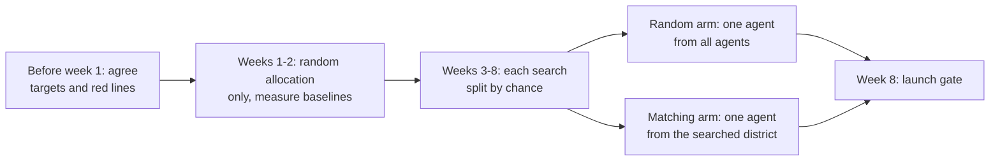
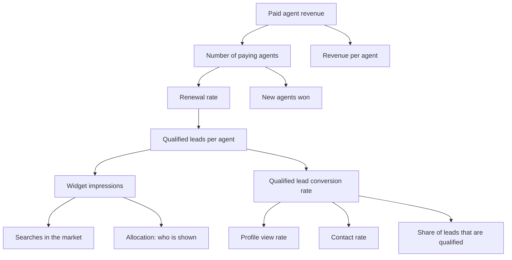

# Business Model and Decision Question

Purpose: capture the product context for Imageboost and the one decision that
the measurement system must support. Handout Part 3.

All content comes from the scenario text in `05-session-handout.md`. Nothing
here was checked with ImmoScout24. Items marked **Assumption** are mine.

## Business model summary

| Area | Notes |
| --- | --- |
| Paying customer | Real estate agents and private landlords. They pay to list and market properties. |
| End user | Consumers who search the platform for a home. They pay nothing. |
| Product promise | To agents: more profile visibility and more contact leads through a promoted profile widget next to the search results. |
| Business outcome | Agents see enough value to keep paying: renewal, upgrade, paid product revenue. |
| User or customer outcome | Agents receive contact leads that are useful. Searchers can reach a fitting agent in one click. |
| Main risk | Visibility without value: leads are few, low quality or unwanted, and the widget annoys searchers or feels unfair to agents. |
| AI-system behavior | Today: random allocation. For every new search a random draw picks one agent. No trained model exists. Later: possibly ranking or targeting. |
| Decision question | Should ImmoScout24 invest further in Imageboost as a paid agent-growth product? |

## The decision in detail

| Option | Meaning | Evidence that would support it |
| --- | --- | --- |
| Scale | Roll Imageboost out to more markets, with the matching rule | Matching beats random by the agreed uplift, guardrails hold |
| Change | Keep piloting and improve the allocation rule | Matching beats random, but by less than the agreed uplift |
| Stop | Stop expansion; fix first, or end the product | Matching is no better than random, or a guardrail is red |

- Who decides: product leadership. **Assumption.**
- When: at a launch gate at the end of a pilot. **Assumption:** 8 weeks.
- Pilot scope: Berlin, rental searches. **Assumption**, taken from the Berlin
  rental example in `02-kpi-design.md`.
- The week-8 decision can rest on lead value only. Renewal, the business
  proof, arrives later and can reopen it.

## Pilot design (proposal, not agreed)

A decision needs a comparison. Random allocation alone gives nothing to
compare with, so the pilot has two phases.

| Design choice | Proposal | Why | Status |
| --- | --- | --- | --- |
| Baseline phase | Weeks 1-2, random allocation for every search | Measures today's behaviour | Assumption |
| Test phase | Weeks 3-8, searches split 50/50 between random and district matching | Both arms run in the same weeks, so season and traffic cancel out | Assumption; needs a leadership decision |
| Matching rule | Show an agent who lists the searched district as a service area | The simplest step beyond random; it is a rule, not a trained model | Assumption |
| No-widget holdout | A small share of searches shows no widget | The only fair test of extra leads and searcher harm | Open: allowed or not? |
| Sample size | Enough leads per arm to tell a real change from chance | Small counts swing by chance | Open: not calculated |

The handout says to treat random allocation as the current behaviour and
not to assume a trained model. The matching rule respects that: it is a
possible next step that the pilot tests.

## Value drivers as a KPI tree

The class slides taught the KPI tree: start at the top number and split it
into the parts that drive it. This tree is my reading of the scenario.

Reading: the business cares about the top box. Imageboost can only move the
lower boxes. The link "more qualified leads lead to more renewals" is a
hypothesis, not a fact (see `hypotheses.md`, H4).

## Is the decision question measurable?

| Check | Answer |
| --- | --- |
| Does it name a choice? | Yes: scale, change or stop |
| Can evidence change the answer? | Yes, if targets and red lines are agreed before the pilot |
| What is still vague? | "Invest further" has no amount. "Paid" has no price model. |
| What must exist first? | A baseline, a comparison (see pilot design), a rule for "qualified lead" |

## Open Questions

- How do agents pay for Imageboost: bundled, per period, or per lead?
- Is the decision owner product leadership, and who exactly?
- Is an 8-week pilot in one market acceptable to leadership?
- Is there a comparison group of similar agents who are not in Imageboost?
- May searches be split between random and matching during the pilot?
- Is a no-widget holdout allowed?
- Do private landlords take part, or only professional agents?
