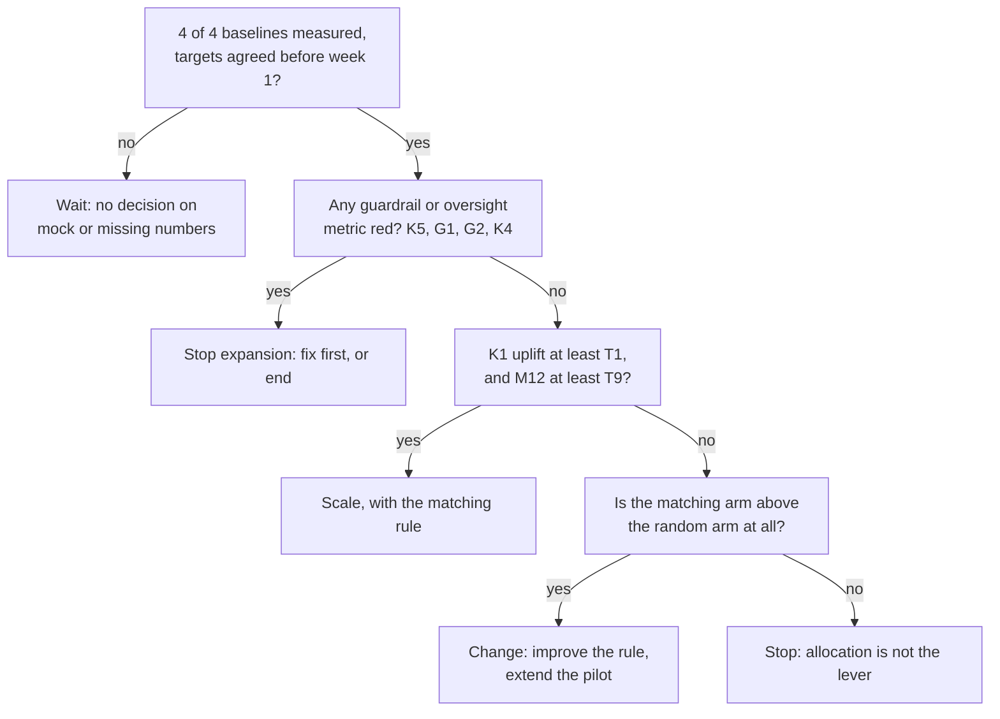

# Governance and Review Cadence

Purpose: say who looks at which number, how often, in which meeting, and
what happens when it moves. Handout Part 9.

Owners are roles, not named people. Forums and rules are proposals. Limits
and bands have no values yet (see `kpi-definition-sheets.md`, Part 7).

## Review table

| Metric or OKR | Owner | Cadence | Review forum | Decision rule | Open validation question |
| --- | --- | --- | --- | --- | --- |
| K1 Qualified lead conversion rate | Product lead | Watched weekly; judged at weeks 4 and 8 | Pilot review: product, data, sales, support | Judged on weeks 3-8, matching against random. Green: uplift at least T1. Amber: above the random arm but below T1. Red: not above the random arm | What signal marks a lead as qualified? |
| K2 Renewal rate gap | Sales lead | Quarterly | Quarterly business review | Zero or negative gap at the first full cycle: review the product promise with agents; the week-8 decision is reopened | Can comparison agents be matched? |
| M12 Agents with a qualified lead | Sales lead | Weeks 4 and 8 | Pilot review | Green: at least T9. Amber: below T9 | Is T9 the same for small and large agents? |
| K3 Relevant-agent display rate | Data analyst | Weekly, and after every allocation change | Pilot review | Green: at least T3 in the matching arm. Red: below T3. Drop after a change: roll the change back | Does the rule agree with human reviewers? |
| K4 Flag override rate | Product lead | Watched weekly; judged monthly | Pilot review | Red: G3 below its limit. Green: G3 fine and K4 inside the band T4. Amber: G3 fine and K4 outside the band, so review the flag rule | Does a review step exist today? |
| K5 Consumer complaint rate | Customer support lead | Weekly, at market level | Pilot review | Green: at or below T5 in every week. Amber: above T5 in one week. Red: above T5 two weeks in a row, so pause the widget | Can complaints be tied to the widget? |
| G1 Exposure concentration | Data analyst | Weeks 4 and 8 | Pilot review | Green: at or below T7 in the matching arm. Red: above T7, so review the matching rule before any rollout | Is even exposure the goal, or exposure by market size? |
| G2 Invalid lead rate | Lead-quality reviewer | Weekly | Pilot review | Green: at or below T8 in every week. Amber: above T8 in one week. Red: above T8 two weeks in a row, so tighten the lead form or flag rule | What counts as a duplicate? |
| G3 Flag review coverage | Lead-quality reviewer | Weekly | Pilot review | Below its limit: K4 is red and review capacity is the first fix | Who reviews, and how fast? |
| Product OKR | Product lead | Mid-pilot (week 4) and end of pilot (week 8) | Launch gate with product leadership | Week 8: scale, change or stop, using the rule below | Are the targets agreed before week 1? |
| Team OKR | Data analyst | Week 3 and week 8 | Pilot review | Fewer than 4 of 4 baselines by week 3: the launch gate moves, the decision waits | Who signs off a baseline? |
| Data pipeline health | Data analyst | Daily, automated | Alert to the data team | Missing or late data: mark the week as not reviewable | Which checks exist already? |

The dashboard prototype uses these same rules for its status colours.

## Launch-gate rule (week 8)

K2 is not in the gate, because it has no data at week 8. A "scale" decision
at week 8 is a decision on lead value. Renewal confirms or reopens it later.

## Cadence map

| Cadence | What is reviewed | Why this speed |
| --- | --- | --- |
| Daily | Data pipeline health | Broken data must be seen before the weekly review |
| Weekly | K3, K5, G2, G3; K1 and K4 are watched only | Pilot signals move within days |
| Weeks 4 and 8 | K1, M12, G1, product OKR | These need several weeks of data per arm |
| Monthly | K4 and all segment views | Flags and small segments are too few to judge weekly |
| Quarterly | K2 | Renewal moves slowly |
| Launch gate (week 8) | Product OKR | One decision: scale, change or stop |

Weekly numbers on small counts swing by chance. In the mock data the random
arm's rate moved by half between two windows although nothing had changed.
A single red week is a prompt to look, not to act.

## AI-system governance

| Question | Answer for the pilot |
| --- | --- |
| Who owns AI-system quality? | Data analyst owns K3 and G1; product lead owns the decision |
| Who can approve threshold changes? | Product lead, recorded in the change log, announced at the next review |
| How are human overrides reviewed? | Monthly sample of overturned flags, read by the product lead and the analyst |
| Which segments are reviewed separately? | Arm, district, agent type, device |
| What happens after drift is detected? | Not relevant for a random draw or a fixed rule. Once a model exists: investigate, roll back if K3 or K1 drops |
| Where are model or rule changes documented? | In the change log below |

## Change log for KPI definitions and allocation rules

| Date | What changed | Why | Approved by | Effect on trends |
| --- | --- | --- | --- | --- |
| 2026-11-15 | First definitions of K1 to K5, G1, G2 written | Workshop | Pending owner review | None: no data yet |
| 2026-11-15 | K1 target changed to matching against random; K3 changed to a computed rule; G3 added; K4 owner and cadence changed | Checkpoint 3 review | Pending owner review | None: no data yet |

## Open Questions

- Who are the named people behind each role?
- Does one weekly pilot review fit, or do support and sales meet apart?
- What is the smallest count on which a rule may fire?
- Who chairs the launch gate?
