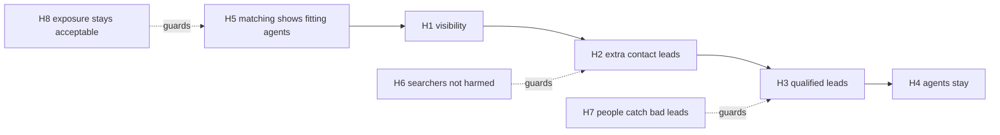

# Hypotheses

Purpose: record what we believe Imageboost does, in a form that numbers can
prove or disprove, before any KPI is chosen. Handout Part 4 and Checkpoint 2.

No hypothesis here has been tested. "Expected evidence" describes what we
would need to see, not what was seen. Thresholds marked **to agree** have no
value yet on purpose: inventing one would break the handout rule.

The comparisons use the pilot design proposed in
`business-model-and-decision-question.md`: weeks 1-2 with random allocation
only, then weeks 3-8 with searches split between random allocation and a
district-matching rule.

## Hypotheses (after Checkpoint 2)

| ID | Hypothesis | Expected evidence | Compared with | Risk or counter-hypothesis | Disproved when |
| --- | --- | --- | --- | --- | --- |
| H1 | Imageboost gives participating agents more visibility | More profile views per participating agent per week | The same agents before the pilot; matched agents outside it | Views are curious clicks that lead nowhere. Views are a proxy: usefulness is tested by H2 and H3 | Views per agent do not rise beyond normal week-to-week swings |
| H2 | Widget impressions turn into extra contact leads | Submitted leads per 10,000 valid widget impressions; total leads per agent | Searches without the widget, if a holdout is allowed (open) | Leads only move from the listing contact path to the widget | Total leads per agent stay flat while widget leads rise |
| H3 | A useful share of these leads is qualified | Share of labelled leads that agents mark as useful | A share **to agree** with agents and sales | Agents label few leads, or label with bias (for example if price depends on lead count) | The qualified share stays below the agreed share, or too few leads get a label to tell |
| H4 | More qualified leads make agents stay | Renewal rate of participating agents is higher | Agents outside the pilot, matched on size, type and district | Agents who join differ from those who do not, so a gap can be selection, not effect. Renewal does not move within 8 weeks | No gap at the first full renewal cycle |
| H5 | Showing an agent from the searched district raises qualified leads per impression | K1 in the matching arm is higher than in the random arm | The random arm in the same weeks | An agent can serve several districts; the district rule may be too crude | The matching arm is not above the random arm by more than chance |
| H6 | The widget does not hurt searchers | Complaint rate stays low; main search use does not fall | Searches without the widget, if a holdout is allowed (open) | Searchers feel advertised to and trust the results less | Complaints or search exits rise above a limit **to agree** |
| H7 | People catch bad leads before agents are bothered | Flags are reviewed; few junk leads reach agents unflagged | Flag volume and review time **to measure** | Review only sees flagged leads. Junk that was never flagged stays invisible | Agents report junk leads that were never flagged above a share **to agree** |
| H8 | Matching keeps exposure acceptable for agents | Top 10 % of agents stay below an agreed share of impressions; most agents get at least one qualified lead | The random arm, where exposure is even by construction | Agents in busy districts with few competitors get most impressions | The top-10 % share crosses the limit, or many agents get no qualified lead |

## How the hypotheses chain together

If one link breaks, everything to its right is unproven. H4 is the business
case, and it is the slowest and weakest link.

## Assumptions behind the hypotheses

| # | Assumption | Needs |
| --- | --- | --- |
| A1 | Every funnel event (impression, view, click, lead) is tracked per search | Data validation |
| A2 | Agents can and will mark leads as useful or not, within 7 days | Stakeholder validation |
| A3 | Comparison agents outside the pilot can be matched on size, type and district | Data validation |
| A4 | "Relevant" can be computed as: the agent lists the searched district as a service area | Stakeholder validation, plus a human-checked sample |
| A5 | Complaints can be linked to the widget | Data validation |
| A6 | A lead review step with flags exists or can be set up | Stakeholder validation |
| A7 | Pilot traffic is large enough to see a change that is not chance | Data validation (sample-size check) |
| A8 | Agent labels are honest enough, and unlabelled leads are not all bad or all good | Stakeholder validation |
| A9 | Searches may be split between random and matching during the pilot | Leadership decision |

## Not turned into hypotheses

These came up in the review. They need research with agents or searchers,
and none exists. They stay as open questions, not as claims.

- Do searchers benefit, beyond not being harmed?
- Are agents willing to pay for Imageboost as its own product?
- Do agents find a random draw fair when they pay for it?

## Checkpoint 2: challenge the hypotheses

A separate Claude reviewer ran the handout prompt on the first version of
this file. That version had seven hypotheses. Changes made after the review:

- H5 held two claims at once (fit and even exposure). It was split into H5
  and H8, and the chain diagram was corrected.
- H1 lost the word "useful": views cannot show usefulness.
- H4 now names selection bias. H7 now measures junk that was never flagged.
- Assumptions A8 and A9 were added. A4 changed from a human label to a rule.

All findings and decisions are in `ai-collaboration-log.md`.

## Open Questions

- Is a no-widget holdout allowed? Without it H2 and H6 have no fair
  comparison.
- How large must a change be before we call it real and not chance?
- Is even exposure the goal, or exposure in line with market size?
- How do we treat agents who serve several districts?
