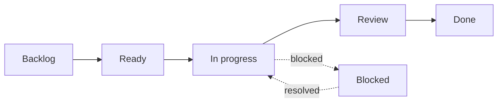

# Measurement Backlog

Purpose: track the measurement-design work for the Imageboost workshop, with
one row per issue, its owner, status, acceptance criteria and open validation.

Handout parts covered: Part 1 (GitHub Project), Part 2 (workshop issues) and
Checkpoint 1 (backlog review).

## What was not possible

- No GitHub Project board and no GitHub issues were created. This file is the
  board, written down. To build the real board, use the tables below.
- There was no group. "Owner" names a role that would own the issue in a real
  team. All rows were worked in one delegated Claude pass on 2026-11-15.

## Part 1: Project board, written as a file

Project name: `KPI and OKR Workshop`. Layout: board.



| Field | Type | Values |
| --- | --- | --- |
| Workstream | Single select | Hypothesis, Metrics, KPI, OKR, Governance, Briefing, Dashboard, Process |
| Metric type | Single select | Activity, Output, Outcome, Impact, Counter-metric |
| Measurement layer | Single select | Business, User, AI-system, Oversight, Risk |
| Confidence | Single select | High, Medium, Low |
| Owner | Assignee | One responsible person |
| Needs validation | Checkbox | Checked when evidence is missing |

Metric type and Confidence describe single metrics. They are filled per
metric in `metric-inventory.md`, not per issue. Layer below names the main
layer an issue serves.

## Part 2: Issues

Status key: **Review** = the artifact is written and waits for the owner's
review. **Blocked** = the "done when" needs people or data that this pass
did not have. Nothing is **Done**: that needs the owner's review.

### The 17 issues suggested by the handout

| # | Title | Workstream | Layer | Owner (role) | Status | Done when | Validation needed |
| --- | --- | --- | --- | --- | --- | --- | --- |
| 1 | Define the Imageboost decision question | Hypothesis | Business | Product lead | Review | One decision question with its three options is in `business-model-and-decision-question.md` | Product leadership confirms this is the decision they face |
| 2 | Map the business model and value drivers | Hypothesis | Business | Product lead | Review | The eight handout areas are filled; a KPI tree links revenue to widget steps | Confirm how agents pay for Imageboost |
| 3 | List candidate company metrics | Metrics | Business | Sales lead | Review | At least three business metrics with denominators are in `metric-inventory.md` | Confirm renewal and upgrade data exist per agent |
| 4 | List candidate Imageboost product metrics | Metrics | User | Product lead | Review | Every funnel step from impression to qualified lead has one metric | Confirm each funnel event is tracked |
| 5 | List candidate AI-system quality metrics | Metrics | AI-system | Data analyst | Review | At least three allocation metrics are listed | Agree the rule for "relevant agent" |
| 6 | List human-oversight and escalation metrics | Metrics | Oversight | Lead-quality reviewer | Review | At least two oversight metrics with denominators | Confirm a lead review step exists today |
| 7 | Identify counter-metrics and risks | Metrics | Risk | Customer support lead | Review | Every selected KPI names a counter-metric that has a formula | Confirm complaints can be tied to the widget |
| 8 | Select primary KPIs | KPI | Business | Product lead | Review | Three to five KPIs are chosen, each with a reason and a rejected alternative | Leadership agrees these drive the decision |
| 9 | Write KPI definition sheets | KPI | User | Data analyst | Review | Each of K1 to K5 has all 14 handout fields filled or marked open; G1 to G3 have a formula, population, cadence and owner | Confirm which lead-quality signals exist in the data |
| 10 | Define SMART targets and baselines needed | KPI | Business | Product lead | Blocked | Every placeholder T1 to T10 has an agreed value and B1 to B5 a measured one | Stakeholder agreement; pilot weeks 1-2 |
| 11 | Draft Imageboost OKRs | OKR | Business | Product lead | Review | One product OKR and one team OKR, each with business or user, AI-system and guardrail key results and an owner per key result | Leadership confirms the objective |
| 12 | Review OKRs for task-based key results | OKR | Business | Product lead | Review | Each key result has a row in "Why these are key results and not tasks" | Owner judges Team KR1, the weakest one |
| 13 | Define review cadence and owners | Governance | Oversight | Product lead | Review | Every KPI, guardrail and OKR has an owner, cadence, forum and decision rule in the review table | Named people accept the owner roles |
| 14 | Prepare measurement strategy briefing | Briefing | Business | Product lead | Review | All nine briefing fields are filled in `measurement-briefing.md` | Rehearse with a real stakeholder |
| 15 | Build static KPI and OKR dashboard | Dashboard | Business | Data analyst | Review | `dashboard/index.html` opens from disk and shows the six required sections | Open in a second browser (only Chrome was checked) |
| 16 | Review dashboard assumptions and mock data labels | Dashboard | Risk | Data analyst | Review | Every simulated value carries a MOCK label; no baseline is shown as validated | Owner finds no unlabelled simulated number |
| 17 | Maintain AI collaboration log | Process | Oversight | Product lead | Review | Each checkpoint has rows with decision and reason in `ai-collaboration-log.md` | Owner confirms or changes each decision |

### Added in the first draft, before the review

| # | Title | Workstream | Layer | Owner (role) | Status | Done when | Validation needed |
| --- | --- | --- | --- | --- | --- | --- | --- |
| 18 | Agree the pilot scope | Hypothesis | Business | Product lead | Blocked | Market, deal type and length are written and agreed | Leadership decision |
| 19 | Check data availability per metric | Metrics | User | Data analyst | Blocked | Each inventory metric is marked tracked, derivable or missing | Access to the event data |
| 20 | Define the qualified-lead signal | KPI | User | Sales lead | Blocked | One written rule says when a lead counts as qualified and who labels it | Agents and sales agree |
| 21 | Define the relevance rule and check it | KPI | AI-system | Data analyst | Blocked | A written rule; two reviewers judge a sample; agreement with the rule is measured | Label agreement test |
| 22 | Generate and document mock pilot data | Dashboard | Risk | Data analyst | Review | A seeded script writes `dashboard/data.js`; the README lists every invented setting | Script re-run gives the same numbers (checked) |
| 23 | Record KPI definition changes | Governance | Oversight | Product lead | Review | A change-log table exists in `governance-and-review-cadence.md` | None |
| 24 | Run validation and write the summary | Process | Oversight | Data analyst | Review | `rumdl` and `git diff --check` pass; `validation-summary.md` lists open items | None |

### Added after Checkpoint 1

| # | Title | Workstream | Layer | Owner (role) | Status | Done when | Validation needed |
| --- | --- | --- | --- | --- | --- | --- | --- |
| 25 | Design the pilot comparison and sample size | Hypothesis | Business | Data analyst | Blocked | The two arms, the holdout question and the smallest count a rule may fire on are written and agreed | Leadership allows the split; a sample-size calculation |
| 26 | Write and own the launch-gate rule | Governance | Business | Product lead | Review | The gate is a flowchart in which every branch can be reached | Leadership accepts the rule before week 1 |
| 27 | Define the flag rule and the review process | Governance | Oversight | Lead-quality reviewer | Blocked | A written rule for duplicate and spam flags; who reviews, and how fast | Confirm what exists today |
| 28 | Write and challenge hypotheses | Hypothesis | Business | Product lead | Review | Each hypothesis has evidence, a comparison and a "disproved when" in `hypotheses.md` | None of the hypotheses is tested |
| 29 | Build the district-matching rule (initiative) | Dashboard | AI-system | Data analyst | Blocked | The rule runs for half of the searches in weeks 3-8 | Engineering; not part of this workshop |
| 30 | Add the "was this lead useful?" button (initiative) | KPI | User | Product lead | Blocked | Agents can label a lead; label coverage is measured | Engineering; not part of this workshop |

Issues 29 and 30 are initiatives: work that makes K1 and K3 measurable.
They are listed so nobody mistakes them for results.

## Example issue in the handout format

```text
Title: Define the qualified-lead signal

Purpose:
Make "qualified lead" mean the same thing to product, sales and agents.

Done when:
- One written rule says when a submitted lead counts as qualified.
- The rule names who gives the label and within how many days.
- The share of leads that receive a label is measured.

Metric, artifact, or decision involved:
K1 Qualified lead conversion rate in kpi-definition-sheets.md.

Validation needed:
Agents and sales agree with the rule. Check that the label can be stored.
```

## Checkpoint 1: backlog review

A separate Claude reviewer ran the handout prompt on the first version of
this file (issues 1 to 24). What changed:

- Statuses did not match their "done when". Both were rewritten so a status
  can be checked against its criterion.
- Issues 25 to 30 were added: pilot comparison, launch gate, flag process,
  hypotheses, and the two initiatives that K1 and K3 depend on.
- "All" was not a valid single-select value for Layer. Each issue now names
  one main layer.
- Not done: splitting issues 9 and 15 into smaller ones. For a solo pass the
  artifacts already exist; a team should split them.

All findings and decisions are in `ai-collaboration-log.md`.

## Open Questions

- Who are the real owners behind the role names? The product lead owns 15 of
  30 issues, which is too many for one person.
- Does a GitHub Project board add value for a solo pass, or only for a group?
- Which blocked issues can start before the pilot scope is agreed?
