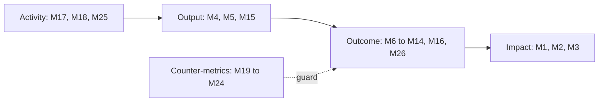

# Metric Inventory

Purpose: list every candidate metric before deciding which few become KPIs.
Handout Part 5.

Confidence means: how sure are we that this number can be measured reliably
today. It is my estimate from the scenario text, not a data check.

## Candidate metrics

| # | Metric | Layer | Type | Why it matters | Possible denominator | Tests | Confidence |
| --- | --- | --- | --- | --- | --- | --- | --- |
| M1 | Paid-agent renewal rate | Business | Impact | Shows whether agents keep paying | Agents whose contract came up for renewal | H4 | Medium |
| M2 | Upgrade rate to a higher plan | Business | Impact | Shows growing willingness to pay | Participating agents | H4 | Low |
| M3 | Revenue from participating agents | Business | Impact | The top of the KPI tree | Participating agents | H4 | Medium |
| M4 | Number of participating agents | Business | Output | Size of the pilot, not value | None: a count | None | High |
| M5 | Widget impressions | User | Output | Exposure volume; the base of most rates | Search result pages | H1 | High |
| M6 | Profile views per agent per week | User | Outcome proxy | Stands in for visibility | Participating agents | H1 | Medium |
| M7 | Profile view rate | User | Outcome proxy | Interest per exposure | Valid widget impressions | H1 | Medium |
| M8 | Contact-button click rate | User | Leading indicator | Early sign of lead intent | Profile views | H2 | Medium |
| M9 | Submitted contact leads | User | Outcome | Direct contact generation | Valid widget impressions | H2 | Medium |
| M10 | Qualified lead conversion rate | User | Outcome | Useful leads per exposure: the value promise | Valid widget impressions | H2, H3 | Low until the quality signal exists |
| M11 | Qualified share of leads | User | Outcome | Lead quality on its own | Submitted valid leads | H3 | Low until the quality signal exists |
| M12 | Share of agents with at least one qualified lead | User | Outcome | Shows whether value reaches many agents | Participating agents | H3, H8 | Low |
| M13 | Relevant-agent display rate | AI-system | Outcome | Checks whether allocation fits the search | Valid widget impressions | H5 | Medium: a rule on profile data, still unchecked |
| M14 | Qualified conversion by allocation arm | AI-system | Outcome | Compares random with matching | Valid widget impressions per arm | H5 | Low until the split is allowed |
| M15 | Widget load time and error rate | AI-system | Output | Operations health of the widget | Widget requests | None | Medium |
| M16 | Flag override rate | Oversight | Outcome | Shows whether reviewers correct the flag rule | Flagged leads reviewed | H7 | Medium |
| M17 | Flag review time | Oversight | Activity | Shows whether review keeps up | Flagged leads | H7 | Medium |
| M18 | Flag review coverage | Oversight | Activity | Zero overrides mean nothing if nobody reviews | Flags raised | H7 | Medium |
| M19 | Consumer complaint rate | Risk | Counter-metric | Protects searcher trust | Valid widget impressions | H6 | Medium |
| M20 | Exposure concentration (top 10 % share) | Risk | Counter-metric | Protects fairness among agents | Impressions of agents active for the full period | H8 | Low until allocation data is confirmed |
| M21 | Invalid lead rate (duplicate, spam) | Risk | Counter-metric | Protects agents from junk | Submitted leads | H3 | Medium |
| M22 | Agent support tickets about Imageboost | Risk | Counter-metric | Early sign of agent frustration | Participating agents | H3 | Medium |
| M23 | Main search exit rate with widget shown | Risk | Counter-metric | Checks the widget does not push searchers away | Search result pages | H6 | Low |
| M24 | Unflagged junk reported by agents | Oversight | Counter-metric | Shows junk that review never saw | Valid leads delivered to agents | H7 | Low |
| M25 | Label coverage | User | Activity | K1 is only as good as the share of leads that get a label | Valid leads | H3 | Low until the label exists |
| M26 | Total leads per agent, all contact paths | User | Outcome | Shows whether widget leads are extra or only moved | Participating agents | H2 | Medium |

Coverage: business 4, user 10, AI-system 3, oversight 4, risk 5. Total 26.

## Sorting the inventory

| Role | Metrics | Note |
| --- | --- | --- |
| Leading (early signal) | M7, M8, M9 | Move within days |
| Lagging (late proof) | M1, M2, M3 | Move after a renewal cycle |
| Proxy (stand-in) | M6, M7 | Views stand in for visibility; the link to value is unproven |
| Vanity risk | M4, M5 | Grow with traffic and sales effort, say nothing about value |

## From inventory to KPI shortlist

| Chosen KPI | From | Why this one | Rejected alternative | Why rejected |
| --- | --- | --- | --- | --- |
| K1 Qualified lead conversion rate | M10 | One rate that carries volume and quality | M9 submitted leads | Says nothing about quality; as a plain count it also grows with traffic |
| K2 Renewal rate gap | M1, compared with matched agents outside the pilot | Closest measurable link to the business outcome | M3 revenue | Mixes in price changes and agent size |
| K3 Relevant-agent display rate | M13 | Explains why leads are or are not qualified | M15 load time | Health check, not allocation quality |
| K4 Flag override rate | M16 | Shows whether human review works | M17 review time | Activity: fast review can still be wrong |
| K5 Consumer complaint rate | M19 | Direct signal of searcher harm | M23 exit rate | Too many other causes |

Kept next to the KPIs: G1 exposure concentration (M20), G2 invalid lead rate
(M21) and G3 flag review coverage (M18). M12 is used as a key result in
`okrs.md`. M25 label coverage is reported with K1. All other metrics stay on
the dashboard backlog.

## Open Questions

- Which of these events are tracked today? (Backlog issue 19.)
- Is M23 measurable without an experiment that hides the widget?
- Which operations metrics already exist for the search page?
