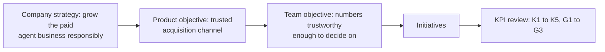

# OKRs

Purpose: one product OKR and one supporting team OKR for the Imageboost
pilot. Handout Part 8 and Checkpoint 4.

Period: the 8-week pilot (assumed). The objectives are proposals. Leadership
has not confirmed them. No target value exists yet.

## The two OKRs

| Level | Objective | Business or user KR | AI-system KR | Guardrail KR | Initiatives |
| --- | --- | --- | --- | --- | --- |
| Product | Make Imageboost a trusted acquisition channel for agents in the pilot market | KR1: Over weeks 3-8, qualified lead conversion (K1) in the matching arm beats the random arm by at least T1. KR2: By week 8, the share of participating agents with at least one qualified lead (M12) reaches T9 | KR3: Relevant-agent display rate (K3) in the matching arm reaches T3 over weeks 3-8 | KR4: Complaint rate (K5) stays at or below T5 in every pilot week; exposure concentration (G1) at or below T7 at weeks 4 and 8; invalid lead rate (G2) at or below T8 in every pilot week | District-matching rule; widget copy test; weekly lead report for agents; "was this lead useful?" button for agents |
| Team (data and analytics) | Make the Imageboost numbers trustworthy enough to decide on | KR1: 4 of 4 pilot baselines (B1, B3, B4, B5) are measured from weeks 1-2 and signed off by their KPI owner by the end of pilot week 3. Today: 0 of 4 | KR2: On a sample of impressions, the relevance rule agrees with two human reviewers in at least T6 of cases | KR3: At least T10 of valid leads get an agent label within 7 days, so K1 does not rest on a small or one-sided sample | Event tracking check; sample-size check; label guide for reviewers; change log; dashboard with real data |

## Owners

| Key result | Owner (role) |
| --- | --- |
| Product KR1 | Product lead |
| Product KR2 | Sales lead |
| Product KR3 | Data analyst |
| Product KR4 | Product lead; the numbers come from the K5, G1 and G2 owners |
| Team KR1 | Data analyst |
| Team KR2 | Data analyst |
| Team KR3 | Sales lead |

## Placeholders

| Placeholder | Meaning | Belongs to | Mock value in the dashboard |
| --- | --- | --- | --- |
| B1, B3, B4, B5 | Baselines measured in pilot weeks 1-2 | K1, K3, K4, K5 | Simulated |
| B2 | Renewal rate of matched comparison agents | K2 | None |
| T1 | Uplift of matching over random | K1 | +15 % |
| T3 | Relevance share | K3 | 50 % |
| T5, T7, T8 | Guardrail limits | K5, G1, G2 | 1.0 per 10,000; 20 %; 10 % |
| T6 | Agreement of rule and reviewers | Team KR2 | None |
| T9 | Share of agents with a qualified lead | M12 | 80 % |
| T10 | Label coverage | Team KR3 | None |

## Why these are key results and not tasks

| Key result | Outcome it measures | Task it could be confused with |
| --- | --- | --- |
| Product KR1 | Agents get more useful leads per exposure | "Build the matching rule" |
| Product KR2 | Value reaches many agents, not a few | "Send lead reports" |
| Product KR3 | Searchers see agents who fit their search | "Build a ranking model" |
| Product KR4 | Growth does not cost trust or fairness | "Set up complaint tracking" |
| Team KR1 | Decisions rest on measured numbers | "Write KPI sheets" |
| Team KR2 | The AI-system metric measures what people mean | "Hold a labelling workshop" |
| Team KR3 | The main KPI rests on enough labels | "Add a feedback button" |

Team KR1 counts a state, not work. It is the weakest of the seven: a team
could sign off poor baselines to reach 4 of 4. The sign-off by the KPI
owner is the check against that.

## Alignment

The company strategy line is taken from the example in
`03-okr-design-and-alignment.md`. It was not confirmed by anyone.

## What is left out on purpose

- **Renewal (K2)** is not a key result. It cannot move inside 8 weeks. The
  week-8 decision therefore rests on lead value, not on business proof. K2
  is checked at the first renewal cycle and can reopen the decision.
- **Flag override rate (K4)** is not a key result. It is a band to stay in,
  not a result to drive. It is reviewed under governance.

## Checkpoint 4: test of OKR quality

A separate Claude reviewer ran the handout prompt on the first version of
this file. Main changes made after the review:

- Key results had no owners. The table above adds them.
- The AI-system KR could not be reached with random allocation, and the
  matching test would have changed what KR1 measured. The pilot now has two
  arms, and KR1 compares them.
- "5 of 5 baselines by week 2" was impossible: K2 has no pilot data and
  labels lag. It is now 4 of 4 by week 3.
- Agent-side value was missing. Product KR2 (M12) was added.
- G2 joined the guardrail KR. G1 is judged at weeks 4 and 8, not weekly.
- "No definition change without a log entry" was a compliance task. It moved
  to initiatives. Label coverage took its place.

All findings and decisions are in `ai-collaboration-log.md`.

## Open Questions

- Does leadership accept "trusted acquisition channel" as the objective?
- What does "trusted" mean in numbers, beyond KR2 and KR4?
- Which values do T1 to T10 take, and who agrees them?
- Should the product OKR carry a renewal KR once renewal data exists?
